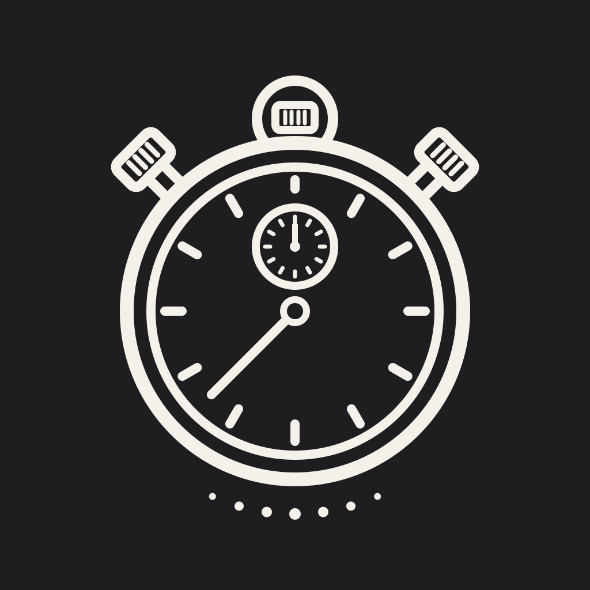

  

<h1 align="center">ScripTimer: Broadcast Timer</h1>

A timer for TV control rooms, studios and live shows.

---

ScripTimer was built by a broadcast technician for the control room and the studio floor, where a one-second drift shows on air.

## Features

- **Three timers at once:** count up, countdown with overrun, and target time (count down to an exact time of day). All three run side by side.
- **Accurate to the second:** timers and clock change together, on the second of the phone clock, and stay exact after the app is backgrounded or relaunched.
- **Quick to set:** dedicated keypad to add or remove time; resets need a one-second hold to avoid mistakes on air.
- **Laps** for each mode, with the gap between laps.
- **Lock Screen and Dynamic Island** through Live Activities.
- **Countdown end alert:** sound, vibration or flash, each optional.
- Keep-screen-on option, dark or light theme, five accent colors.
- English and French.

Requires iPhone with iOS 17 or later.

**Download:** App Store link coming soon.

## Support

Questions, bug reports or ideas: jj.rousselet@gmail.com

**The countdown alert does not ring.** Sound, vibration and flash are off by default: turn them on in the app settings (gear icon), under Countdown end alert. In the background, the alert comes as a notification, so allow notifications for ScripTimer in the iPhone Settings app.

**The timers are not on the Lock Screen.** Check that Live Activity is on in the app settings and that Live Activities are allowed for ScripTimer in the iPhone Settings app.

**The screen turns off during a show.** Turn on Keep screen on in the app settings.

## Privacy policy

*Last updated: November 23, 2026*

ScripTimer collects no data.

- No account, no sign-in, no advertising, no analytics, no tracking.
- The app does not connect to the internet and sends nothing to the developer or to third parties.
- Timer values, laps and settings are stored only on your device so that timers can resume after the app is closed. Deleting the app deletes this data.
- **Notifications** are used only to announce the end of a countdown while the app is in the background. They are scheduled on the device.
- **Live Activities** show the timers on the Lock Screen and in the Dynamic Island. Their content stays on the device.
- **Flashlight:** the camera light can blink as an alert if you turn this option on. No photo or video is ever taken.

Contact about this policy: jj.rousselet@gmail.com

---

© 2026 Alzareus
